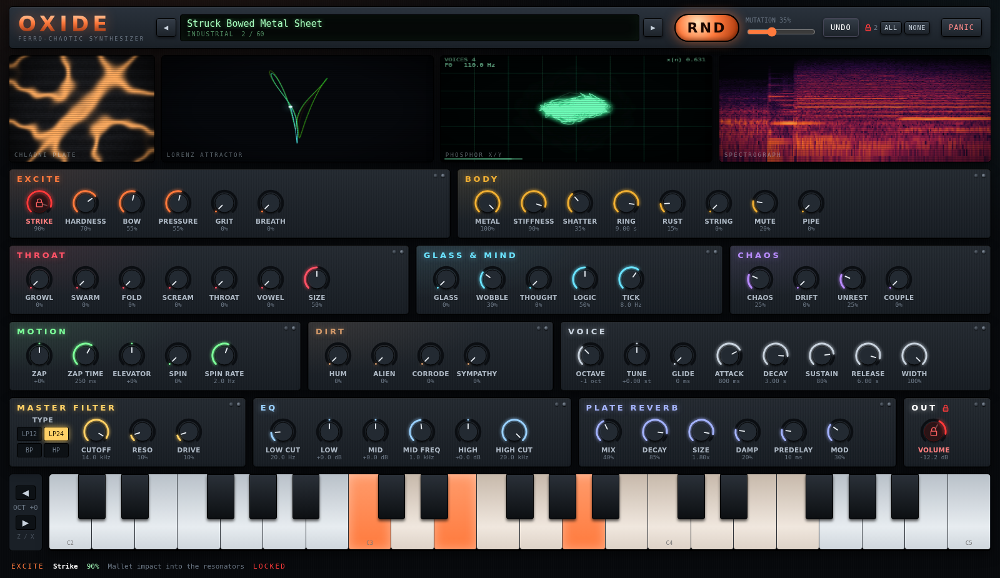

# OXIDE: a very strange synthesizer

A browser synth written in Rust. It uses Dioxus for the UI and a Rust DSP engine running inside an AudioWorklet.
It makes metal squeal under a bow and runs Lorenz chaos through formant monsters. Its machine "thoughts" are blips driven by the logistic map.



## Running

```sh
rustup target add wasm32-unknown-unknown
cargo install dioxus-cli --version 0.7.10   # or: cargo binstall dioxus-cli@0.7.10

cd crates/app
dx serve --platform web            # dev server, http://localhost:8080
dx build --platform web --release  # static site in target/dx/oxide-app/release/web/public
```

`dx build` writes root-absolute `/assets/...` URLs, so that output only works at the web server root. To get a build you can serve from any subfolder, run `tools/build_web.sh` from anywhere instead. It runs the same release build and then rewrites those URLs to page-relative ones. Link to the folder with a trailing slash (`/synth/`, not `/synth`), or the relative paths resolve one level too high.

Click **IGNITE** to start audio. Browsers only allow audio after a user gesture.

## Playing

| Action | How |
| --- | --- |
| Play | On-screen keys (click lower on a key for a louder note), computer keys `A W S E D F T G Y H U J K O L P ; '`, or any Web MIDI input |
| Octave | `Z` / `X`, or the arrows next to the keyboard |
| Adjust knob | Drag vertically, or scroll. Alt-drag gives fine control |
| Reset knob | Double-click |
| **Lock** | **Shift-click** any knob or the filter-type switch. Shift-click a section title to lock or unlock the whole section |
| **RND** | Mutates every unlocked parameter. *Mutation* sets how far it jumps. **UNDO** steps back through RND and preset changes |
| Lock ALL / NONE | Buttons next to RND |

Volume starts out locked so that RND can't blast or mute you. Shift-click it to unlock.

## The 39 strange parameters

| Section | Parameters |
| --- | --- |
| **Excite** | Strike, Hardness (felt → steel mallet), Bow (stick-slip friction), Pressure (lean on it for screech), Grit (rust-flake crackle), Breath |
| **Body** | Metal (16-mode resonant body), Stiffness (string → bar → plate → bell), Shatter (cracked-casting mode scatter), Ring, Rust (high-mode damping), String (waveguide), Mute, Pipe (closed tube) |
| **Throat** | Growl (subharmonic, jittery saw), Swarm, Fold (wavefolder), Scream (feedback FM), Throat (formants), Vowel (A-E-I-O-U), Size (creature size) |
| **Glass & Mind** | Glass (wine-glass partials), Wobble (beating), Thought (logistic-map blips), Logic (r: order → chaos), Tick |
| **Chaos** | Chaos (Lorenz speed, from drift to audio-rate turbulence), Drift (Lorenz → pitch), Unrest (Lorenz → modes, vowel, bow), Couple (oscillators shake the resonators) |
| **Motion** | Zap (pitch dive/rise), Zap Time, Elevator (pitch keeps travelling while held), Spin (rotating-body Doppler and pan), Spin Rate |
| **Dirt** | Hum (mains buzz), Alien (ring mod at √7), Corrode (bit/rate crush), Sympathy (a hidden metal frame that resonates along) |

There are also 25 conventional parameters:

- **Voice**: octave, tune, glide, ADSR, width.
- **Master filter**: a zero-delay-feedback Moog ladder with LP12, LP24, bandpass and highpass modes, plus cutoff, resonance and drive.
- **EQ**: low cut, low shelf, mid peak with frequency, high shelf, high cut.
- **Plate reverb**: Dattorro's plate at the very end of the chain, with mix, decay, size, damping, predelay and modulation.
- **Out**: volume.

## Factory presets (60)

- **Industrial**: Metal-on-Metal Screeching Industrial Elevator, Struck Bowed Metal Sheet, Resonating Metal Clothes Rack, Rusted Boiler Room, Freight Container Door, Factory Floor at 3AM, Sheet Metal Thunder, Hydraulic Press Lament, Submarine Hull Stress
- **Sci-Fi**: UFO Engine Room, Godzilla Laser Beam, Tractor Beam, Hyperspace Ignition, Alien Telegraph, Mothership Choir, Dead Satellite, Teleporter Malfunction, Quantum Foam, Cryo Chamber Hum
- **Creatures**: T-Rex Roar, Kaiju Footstep, Leviathan Song, Swamp Thing Gurgle, Insect Hive Mind, Banshee, Cave Troll Snore, Dragon Breath, Gargoyle Choir, Hungry Ghost
- **Glass**: Haunting Singing Glass, Crystal Lattice, Frozen Lake Cracks, Wine Glass Armonica, Ice Cave Wind, Broken Music Box, Prism Bells
- **Machine**: Thoughts of the Machine, Lorenz Butterfly, Logistic Bifurcation, Modem Prayer, Circuit Bent Toy, Corrupted Memory, Neural Static, Clockwork Heart
- **Percussion**: Hitting Muted Strings with a Plastic Pipe, Rebar Harp, Chain-Link Fence Rain, Haunted Gamelan, Bent Spoon Kalimba, Oil Drum Bass, Gong from the Deep, Plastic Bucket Drum, Tuned Radiator, Bowed Saw Blade
- **Drones**: Abandoned Steel Mill, Rust Belt Drone, Deep Sea Cable, Cathedral of Pipes, Void Choir, Solar Wind

All presets are loudness-matched to −16 dB short-term level (see *Tooling*).

## Visuals

- **Chladni plate**: each ringing mode of the metal body maps to a square-plate mode (n, m). Sand settles on the nodal lines of their superposition. Patches without a metal body shape the plate from the chaos state instead.
- **Lorenz attractor**: the engine's own chaotic state, streamed from the worklet and rotating in 3D.
- **Phosphor X/Y**: a mid/side Lissajous scope with persistence, showing voice count, F0 and the logistic state.
- **Spectrograph**: scrolling, with a log-frequency axis.

## Architecture

```
crates/core   oxide-core: parameter table, presets, RND mutation, telemetry layout (shared)
crates/dsp    oxide-dsp: the engine. Plain Rust, no deps. Built natively for tests and
              offline rendering, and as a bare wasm32 module with a C ABI
crates/app    oxide-app: Dioxus 0.7 web UI
tools/        dev aids: spectrogram plots, loudness calibration, headless-browser e2e test
```

- `crates/app/build.rs` compiles `oxide-dsp` for `wasm32-unknown-unknown` in its own target directory. The app then embeds the resulting ~100 KB module with `include_bytes!`.
- At IGNITE, `audio.rs` loads `worklet.js` from a Blob URL and hands the wasm bytes and initial parameters to the `AudioWorkletProcessor`.
- The processor instantiates the module with no imports and calls `oxide_process` on every 128-frame block.
- Parameters and notes travel to the worklet as port messages. Telemetry (Lorenz trail, mode energies, levels) comes back at about 60 Hz to drive the visuals.

Signal flow per voice:

```
strike/grit/breath ─┬─► modal metal body (16 modes) ◄─► stick-slip bow
                    └─► waveguide string                   │
growl/swarm/scream/fold/glass/thoughts (× ADSR) ── couple ─┘
          body + oscillators ─► pipe ─► throat (formants) ─► alien ─► spin ─► L/R
Lorenz ─► drift (pitch), unrest (modes/vowel/bow)
```

The global chain runs: voices → hum → sympathetic frame → corrode → ladder filter → EQ → Dattorro plate → volume → soft clip.

The worst case (every module on, 8 voices) costs about 7% of one core in Chromium.

## Tooling

```sh
cargo test -p oxide-core -p oxide-dsp       # params, presets, mutation, engine stability
cargo run -p oxide-dsp --release --example render                  # render every preset to renders/*.wav + stats
cargo run -p oxide-dsp --release --example render -- "T-Rex"       # filter by name
cargo run -p oxide-dsp --release --example render -- Init bow=0.8 press=0.9   # override params by key
cargo run -p oxide-dsp --release --example render -- --calibrate | python3 tools/apply_calibration.py
python3 tools/spectro.py out.png renders/*.wav   # needs numpy + matplotlib
python3 tools/e2e.py http://localhost:8080/ /tmp/shots   # needs websocket-client + chromium
```
